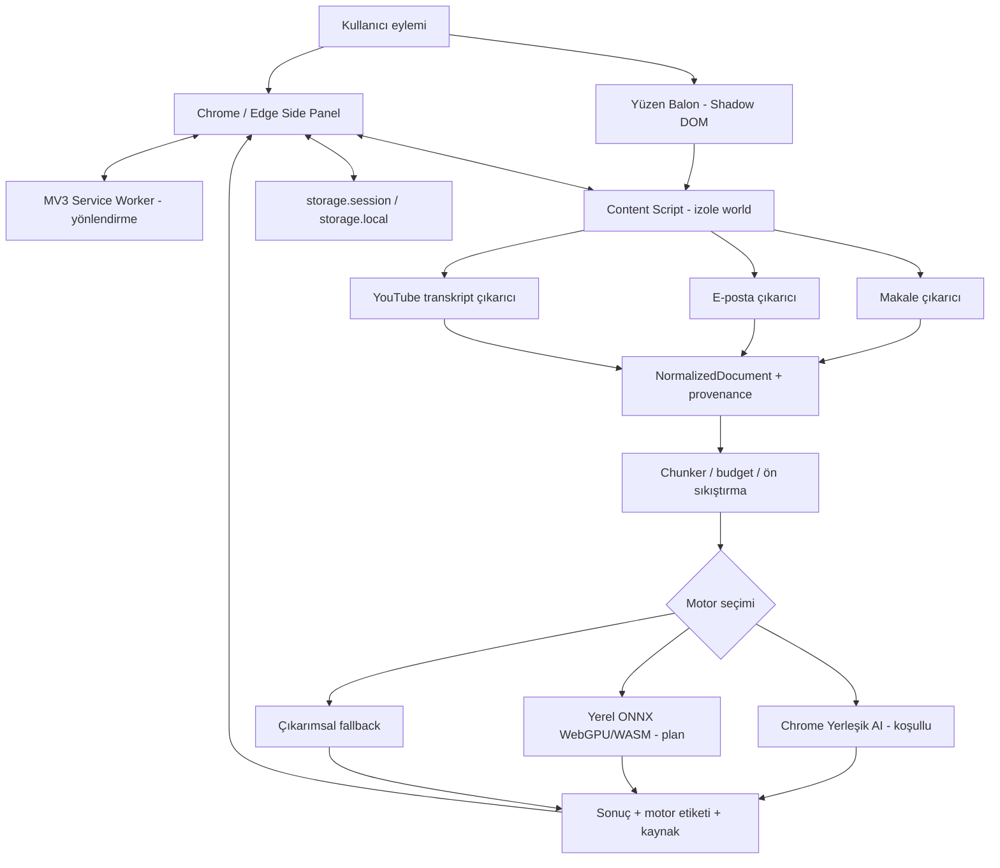

# OkuLens — Yerel Yapay Zekâ Destekli Tarayıcı Okuma ve Özetleme Asistanı

> **Proje türü:** Chrome / Microsoft Edge uzantısı · Manifest V3 · Yerel-öncelikli · Açık kaynak
>
> **Depo adı:** `OkuLens` · **GitHub deposu:** [seydivakkas/OkuLens](https://github.com/seydivakkas/OkuLens)
>
> **Durum (18 Ekim 2026):** **v0.4.0 geliştirme prototipi (P4 üretken ONNX adaptörü: sentetik PASS; model ağırlıkları ve gerçek Chrome/Edge inference HOLD).** Bu README hem ürünün **hedef sözleşmesini** hem de prototipte **gerçekte bulunan işlevleri** açıkça ayırır. Canlı mağaza yayını, tüm tarayıcılar, yerel üretken Türkçe model, kararlı YouTube altyazısı ve doğrulanmış performans **henüz sağlanmış kabul edilmez**.

**OkuLens**, bir web sayfasında seçilen metni, makaleyi, e-posta gövdesini veya mevcut YouTube transkriptini kullanıcının istediği seviyede anlaşılır kılmayı amaçlayan; okuma sayfasını terk ettirmeden tarayıcının yerleşik yan panelinde çalışan bir asistandır. Önceliği **yerel işleme, kullanıcı kontrolü, kaynakla ilişkilendirme ve aboneliksiz kullanım**dır. Kullanıcının içeriği üçüncü taraf bir LLM API'sine varsayılan olarak gönderilmez.

## İçindekiler

1. [Vizyon ve temel ilkeler](#1-vizyon-ve-temel-ilkeler)
2. [Kapsam, hedef kullanıcılar, kapsam dışı](#2-kapsam-hedef-kullanıcılar-kapsam-dışı)
3. [Özellik matrisi ve gerçek uygulama durumu](#3-özellik-matrisi-ve-gerçek-uygulama-durumu)
4. [Kullanıcı yolculukları](#4-kullanıcı-yolculukları)
5. [Arayüz sözleşmeleri](#5-arayüz-sözleşmeleri)
6. [Teknik mimari ve yürütme bağlamları](#6-teknik-mimari-ve-yürütme-bağlamları)
7. [Manifest, izinler ve site erişimi](#7-manifest-izinler-ve-site-erişimi)
8. [İçerik çıkarım motoru](#8-içerik-çıkarım-motoru)
9. [Özetleme, yeniden yazma ve kelime bütçesi](#9-özetleme-yeniden-yazma-ve-kelime-bütçesi)
10. [Yerel yapay zekâ motorları ve Türkçe](#10-yerel-yapay-zekâ-motorları-ve-türkçe)
11. [Hiyerarşik parçalama ve kaynak kanıtları](#11-hiyerarşik-parçalama-ve-kaynak-kanıtları)
12. [Sekme durumu, depolama ve önbellek](#12-sekme-durumu-depolama-ve-önbellek)
13. [Mesaj protokolü ve iş kimlikleri](#13-mesaj-protokolü-ve-iş-kimlikleri)
14. [Gizlilik, güvenlik ve tehdit modeli](#14-gizlilik-güvenlik-ve-tehdit-modeli)
15. [Hata yönetimi ve düşüş stratejisi](#15-hata-yönetimi-ve-düşüş-stratejisi)
16. [Performans ve kaynak yönetimi](#16-performans-ve-kaynak-yönetimi)
17. [Proje dizin düzeni](#17-proje-dizin-düzeni)
18. [Geliştirme ve yerel kurulum](#18-geliştirme-ve-yerel-kurulum)
19. [Test, doğrulama ve kabul kriterleri](#19-test-doğrulama-ve-kabul-kriterleri)
20. [P0–P9 geliştirme yol haritası](#20-p0p9-geliştirme-yol-haritası)
21. [GitHub iş akışı ve sürüm politikası](#21-github-iş-akışı-ve-sürüm-politikası)
22. [Açık teknik kararlar ve risk kayıtları](#22-açık-teknik-kararlar-ve-risk-kayıtları)
23. [Sorun giderme ve SSS](#23-sorun-giderme-ve-sss)
24. [Kaynaklar, lisans ve katkı](#24-kaynaklar-lisans-ve-katkı)

---

## 1. Vizyon ve temel ilkeler

**Ürün sözü:** *Okuduğunu daha hızlı kavra; kaynağından kopma.*

- **Privacy-first:** Varsayılan işleme tarayıcı/cihaz üzerindedir. Gizli veya kişisel içerik uzaktaki AI servislerine gönderilmez.
- **Offline-first, ama dürüst durum bildirimi:** İndirilen/kurulan yerel modelle ağsız çıkarım hedeflenir; model ilk kurulurken indirme gerekebilir. Model yoksa üretken AI yapılmış gibi davranılmaz.
- **Source-first:** Kaynak başlık/URL, alıntı konumu, YouTube zaman damgası ve işlemin sınırlamaları korunur.
- **User-triggered:** Kullanıcı seçimi, uzantı simgesi veya izin verilmiş komut olmadan e-posta/sekme içeriği otomatik toplanmaz.
- **No API-key:** Zorunlu bulut LLM API'si, servis aboneliği, kullanıcı hesabı veya arka uç sunucusu bulunmaz.
- **Az bağımlılık:** Birbiriyle örtüşen NLP modülleri aynı işi tekrar etmek için eklenmez.
- **Türkçe-öncelikli UX:** Arayüzün tamamı Türkçedir. Üretken Türkçe desteği ancak gerçek model ve donanım testinden sonra etkin ilan edilir.
- **Windows-first:** Yerel geliştirme ve kabul ortamı Windows 10/11 masaüstüdür; Chrome ve Edge ayrı doğrulanır.
- **Erişilebilir:** Klavye, belirgin odak halkası, küçük ekran, yüksek kontrast ve ekran okuyucu desteği hedeflenir.

### Mimari kalite özellikleri

| Nitelik | Hedef davranış | Doğrulama yöntemi |
|---|---|---|
| Doğruluk | Kaynakta olmayan bilgi eklenmez; üretken çıktı uyarı ve kanıt bağlantısıyla sunulur | Altın veri + insan incelemesi |
| Yerellik | Özet için harici API çağrısı yapılmaz | Ağ isteği denetimi |
| İzin | Asgari yetki; per-site etkinleştirme | Manifest + izin incelemesi |
| Dayanıklılık | Service worker kapanınca özet durumu bozulmaz | Yeniden başlatma senaryoları |
| Kullanılabilirlik | Uzun analiz yan panelden okunur, sayfa kaydırılabilir | Chrome / Edge UI kabulü |
| Bakım | Çıkarıcılar platform başına ayrılmıştır | Birim ve entegrasyon testleri |
| Şeffaflık | Çıktının motoru, gerçek kelime sayısı, kaynak ve belirsizlik gösterilir | Arayüz kontrolü |

## 2. Kapsam, hedef kullanıcılar, kapsam dışı

### Hedef kitle

- Öğrenci ve araştırmacı: İngilizce/Türkçe teknik metinleri farklı seviyelerde kavramak.
- Yazılımcı: Uzun teknik dökümantasyonu konu bağlantılarıyla özetlemek.
- Profesyonel: E-posta konuşmalarının özünü seçili mesaj/konuşma düzeyinde almak.
- Video izleyicisi: Var olan altyazı transkriptini zaman damgalı olarak gözden geçirmek.
- Erişilebilir okuma ihtiyacı olan kullanıcı: Uzun, jargonlu içeriği daha yalın görmek.

### Dahil edilen hedefler

1. Seçili metin üzerinden **10 kelimelik mikro özet**.
2. Makale/e-posta/video metninden **100 kelimelik standart özet**.
3. Uzun metinde bölümlendirilmiş **1000 kelimeye kadar derin analiz**.
4. **Kolay / Orta / Zor** anlatım modları; uygun üretken motor varsa gerçek yeniden yazım.
5. **Side Panel** üzerinden kaynaklar, özet geçmişi, kopyalama, indirme ve iptal.
6. **YouTube** altyazı varsa zaman damgası, tıklayarak videoda konumlama.
7. Gerçek zamanlı üretim için **streaming**; desteklenmediğinde açıkça toplu işleme durumu.
8. Bölgesel/donanımsal destek yoksa yerel **extractive fallback**.

### Kapsam dışı (v1)

- Uzak SaaS sunucusu, API anahtarı ve zorunlu hesap.
- Ses veya videodan sıfırdan konuşma tanıma (STT); yalnızca mevcut altyazılar.
- PDF OCR, Office belgeleri, e-kitap EPUB desteği.
- Telif/protokol kısıtlarını aşacak YouTube imza kırma veya erişim kontrolü atlatma.
- Gizli e-posta verisinin istemsiz/arka planda toplu taranması.
- Doğrulanmamış `1000 kelime = bütün bilgiyi korur` garantisi.
- Klasik topic modeling, embedding veritabanı veya RAG sunucusu.

## 3. Özellik matrisi ve gerçek uygulama durumu

Burada **P0 = paket içindeki kaynak kod**, **Plan = henüz yazılmadı**, **Koşullu = dış tarayıcı/donanım tarafından sağlanabilir** anlamındadır. Hiçbiri son kullanıcı kabulünü temsil etmez.

| Özellik | Hedef | 0.1.0 kaynak durumu |
|---|---|---|
| MV3 manifest / service worker | Chrome + Edge | **P0 kodlandı**, cihazda kabul bekliyor |
| Side Panel ana ekranı | Sekmeye bağlı kullanım | **P0 kodlandı**, tarayıcıda kabul bekliyor |
| Makale gövdesi | Readability.js + seçici fallback | **Readability 0.6.0 + seçici fallback (Issue #2; gerçek tarayıcı HOLD)** |
| Metin seçimi | Yüzen balon | **P0 deneysel**, kullanıcı açılışıyla etkin |
| 10/100/1000 hedefleri | Kelime bütçesi ve kaynak uyarısı | **P0 extractive hedefleme**, kesin kelime garantisi yok |
| Kolay/Orta/Zor | Üretken stil uyarlama | **P0 UI**, gerçek üretken uyarlama **Koşullu/Plan** |
| Yerleşik Summarizer | Chrome uygun dil/donanım | **Koşullu entegrasyon**, cihazda denenmedi |
| Türkçe lokal ONNX modeli | GPU/WASM | **P4 koşullu Worker/adaptör kodu mevcut; model paketi kurulmadı, gerçek inference HOLD** |
| E-posta | Gmail/Outlook | **P3 kapsam seçimi + bağımsız DOM adaptörleri**, sentetik PASS; canlı hesap kabulü HOLD |
| YouTube | Altyazı/zaman damgası | **P3 açık transkript DOM + doğrulanan zaman damgası**, sentetik PASS; imzalı altyazı erişimi kapsam dışı/ayrı değerlendirme |
| Hiyerarşik Map-Reduce | Çok uzun belgeler | **Plan** |
| Gerçek AI streaming | Uygun native/model motorunda | **P0 native akış nesnesi koşullu**, parça parça UI gösterimi **Plan** |
| Sekme özeti hatırlama | `storage.session` | **P0 kodlandı**, kabul bekliyor |
| Onboarding ve izin yönetimi | Site bazlı izin | **Plan** |
| Model yöneticisi / indirme | SHA/lisans/erişim | **Plan** |
| Popup | Yardımcı kısa arayüz | **Plan**; uzantı ikonu panel açar |
| Otomatik uçtan uca tarayıcı testi | Playwright | **Plan** |
| Chrome/Edge mağaza yayını | Denetimli dağıtım | **Plan** |

### Kullanıcıya asla yanlış söylenmeyecek durumlar

- Cümle seçip önemli cümleleri sıralamak **üretken yeniden yazım** değildir.
- `short/medium/long`, doğrudan `10/100/1000 kelime` parametresi değildir.
- YouTube altyazısı bulunmazsa transkript varmış gibi sonuç üretilmez.
- `Summarizer` nesnesinin bulunması, modelin indirilmiş ve hazır olduğunu kanıtlamaz.
- `WebGPU` nesnesinin bulunması, seçilmiş ONNX modelinin uyumlu ve hızlı olduğunu kanıtlamaz.
- Paket içinde model yoksa tam offline üretken Türkçe yeteneği **yoktur**.

## 4. Kullanıcı yolculukları

### S1 — Mikro özet: metin seçimi

1. Kullanıcı siteyi ziyaret eder, içerik seçer.
2. Kullanıcı ilgili sitede uzantıyı açmışsa küçük, izole balon belirir.
3. `Özetle` seçimi ile yan panelin 10 kelime modu açılır; sonraki iterasyonda gerçek sayfa içi AI önizlemesi eklenir.
4. Kullanıcı özetin üretken mi yoksa çıkarımsal mı olduğunu görür.
5. Balon seçim kaldırılınca veya Escape ile kapanır; sayfanın mevcut düğümleri silinmez.

**Başarı:** Sayfa düzeni bozulmaz; kullanıcı kaynağı okumaya devam edebilir. **P0 sınırlaması:** Balonun çalışması için sekmede uzantının önce etkinleştirilmesi gerekir; global her sitede sessiz çalışan ajan değildir.

### S2 — Makale: 100 kelime

1. Kullanıcı tarayıcı araç çubuğundaki OkuLens simgesine basar.
2. Tarayıcının kendi yan paneli açılır, aktif sekme seçilir.
3. İçerik çıkarıcı Readability (hedef) veya `article/main/[role=main]` fallback ile saf metin hazırlar.
4. `100 kelime`, `Orta`, `Özetle` seçilir.
5. Model uygunsa yerel üretken özet, değilse kaynak cümlelerine dayalı etiketli extractive özet gösterilir.
6. Kullanıcı kopyalar, dışa aktarır veya ayarı değiştirerek yeniden çalıştırır.

**Başarı:** Kullanıcı makale ile özeti yan yana görür. Metnin tümünü depolamak zorunlu değildir.

### S3 — Derin analiz: 1000 kelime

1. Uzun teknik metin alınır; bölüm başlığı/yapısına göre ayrılır.
2. Her parça için kapsam, birim ve kaynak ofseti tutulur.
3. Her parçaya kontrollü yerel sentez uygulanır; nihai rapor bölüm bölüm oluşturulur.
4. Rapor, kapsanmayan bölümleri ve model sınırını gösterir.
5. Kullanıcı başka sekmeye geçip döndüğünde özet durumu hatırlanır.

**Başarı:** Kapsama dengeli dağılır, kaynakta olmayan yeni iddialar üretilmez. **P0:** Hiyerarşik üretken analiz tamamlanmadı; cümle tabanlı uzun extractive çıktı 1000 kelimenin eşdeğeri değildir.

### S4 — Gmail / Outlook

1. Kullanıcı e-posta sekmesinde uzantıyı bilerek çalıştırır.
2. Yalnızca görünür/aktif mesaj veya açık konuşma zinciri toplanır.
3. Alıntılanmış önceki zincir, imza, gizli form alanları ve taslak metni mümkün olduğunca ayıklanır.
4. Panel içerik kaynağını `E-posta` olarak etiketler, hassas veri uyarısını gösterir.
5. Varsayılan olarak ham e-posta gövdesi kalıcı depoya yazılmaz.

**Risk:** Gmail `.a3s`/`.aiL` veya Outlook DOM seçicileri değişebilir. Çıkarılan mesaj sayısı ve kapsamı UI'da doğrulanmalıdır; yanlış DOM eşleşmesi sessizce 'başarılı' sayılmaz.

### S5 — YouTube

1. Kullanıcı video sayfasını ve varsa **Transkripti göster** bölmesini açar.
2. OkuLens mevcut altyazı segmentlerini okur, zaman kodlarını saklar.
3. Özet oluşturulur, kritik bölümlerde zaman kodu listelenir.
4. Zaman koduna tıklanınca ilgili `video` oynatıcısı destekliyorsa `currentTime` değiştirilir.
5. Erişilemeyen, devre dışı veya üretilmemiş altyazı için `TRANSCRIPT_UNAVAILABLE` verilir.

**Karar:** YouTube'un iç `ytInitialPlayerResponse`, imzalı `baseUrl`, Innertube/timedtext endpointleri **kamusal ve kararlı bir uzantı sözleşmesi değildir**. Birden fazla strateji koşullu olarak uygulanabilir; her biri hata toleranslı ve sürdürülebilir olmalıdır. P0 açık transkript DOM yöntemidir.

## 5. Arayüz sözleşmeleri

### 5.1 Sayfa A — Yüzen balon / `FloatingBubble`

**Hedef görünüm:** Seçimin hemen yakınında ufak çubuk: `10 kelime`, `Özetle`, `Yan panel`. Uzun paragraf veya 1000 kelimelik içerik balonda gösterilmez.

- Seçili metin minimum eşik üstündeyse göster.
- `ShadowRoot` içinde izole CSS kullan; sayfanın `body` stiline genel kural enjekte etme.
- Ekran dışına taşmayacak konum düzeltmesi (`getBoundingClientRect` + viewport clamp).
- `pointerdown` ile seçimi kaybetme sorununa karşı seçim anlık görüntüsü al.
- Sayfa seçimi silinince/ESC/route değişince gizlen.
- Tek bir kapsayıcı; yenilenen içerik betiği ikinci balon oluşturmaz.
- Uygunsuz/kapalı site ve kullanıcı izin iptalinde sıfır içerik göster.
- **P0:** Sadece `Panelde aç` / `Seçimi özetle` köprüsü bulunur; 10 kelimelik bağımsız AI tooltip aşaması tamamlanmadı.

### 5.2 Sayfa B — Yerleşik Yan Panel / `SidePanel`

**Bölümler:**

- Üst: OkuLens simgesi, aktif kaynak başlığı, alan adı, kaynak tipi, işlem durumu.
- Mod seçicileri: `10 | 100 | 1000` ve `Kolay | Orta | Zor`.
- Motor: `Otomatik`, sonraki sürümde `Chrome AI`, `Yerel ONNX`, `Çıkarımsal`.
- Ana eylem: `Özetle`, işlem anında `İptal` ve `Tekrar dene`.
- Sonuç: Metin/Markdown, gerçek kelime sayısı, kullanılan motor, kaynak uyarısı.
- Kaynak: makale bağlantısı veya video zaman damgaları.
- Eylemler: `Kopyala`, `.md` olarak indir, yeni özet, temizle.
- Durumlar: `boş`, `kaynak bekleniyor`, `hazır`, `işleniyor`, `kısmi`, `tamamlandı`, `hata`, `iptal edildi`.

**1000 kelime ilkesi:** Sadece yan panelin kaydırılabilir içerik alanında veya bağımsız geniş görüntüde göster; tooltip ve popup'ta değil. Panel görünümü web sayfasından ayrı bir extension origin üzerinde çalışır. Bu, **tarayıcı içinde izole belge bağlamı** demektir; OS düzeyinde yeni bir 'native window' veya tüm CSS saldırılarına karşı matematiksel sıfır çakışma garantisi değildir.

### 5.3 Sayfa C — Popup (plan)

Kısa durum / gizlilik / aktif motor / `Yan Paneli Aç` / `Ayarlar` / yardım. **Not:** Aynı uzantı `action.default_popup` ve simge üzerinden `openPanelOnActionClick` davranışlarını gelişigüzel birlikte tanımlamaz. Ürünün birincil eylemi panel açmak olduğundan P0'da popup yoktur.

### 5.4 Sayfa D — Ayarlar

Alanlar: varsayılan uzunluk, varsayılan zorluk, özet türü (`tldr`,`key-points`,`headline`,`teaser`), motor seçimi, Türkçe/açıklama dili, otomatik özetleme kapalı/açık, gizlilik önbellek davranışı, dosya dışa aktarma. P0'daki ayar sayfası yalnızca yerel tercihleri saklar.

### 5.5 Sayfa E — Onboarding / İzin (plan)

Aşamalı kartlar:

1. Uygulama hangi sitelerde çalışır?
2. `activeTab` geçici yetkisi nasıl verilir?
3. Gmail / Outlook hassas içerikleri nasıl korunur?
4. Chrome model indirme gereksinimleri nelerdir?
5. Yerel ONNX modelinin lisansı, boyutu, SHA-256 ve depolaması.
6. Yan panel davranışı ve ilk kullanım testi.

**CTA:** `Bu sekmede çalıştır`, `Site için izin ver`, `İzinleri yönet`, `Daha sonra`.

### 5.6 Sayfa F — YouTube bölüm gezgini (plan)

Zaman kodu, transkript cümlesi, bölüm özeti, aranabilir segmentler. Tıklanan damga videoyu uygun konuma götürür. Otomatik altyazı ve el ile yüklenen altyazılar ayrı işaretlenir. Yerel altyazı yoksa kullanıcıya altyazı açma adımı verilir.

### 5.7 Görsel sistem

- Çalışma aralığı: **Side Panel dar mod** yaklaşık 320–480 CSS px; kırılım bazlı CSS, sabit genişlik zorlaması yok.
- Tasarım dili: nötr zemin, yüksek kontrast, tek ana vurgu rengi, okunur sistem fontları, ikon + etiket.
- Durum rengi tek bilgi kaynağı olmaz; metinsel açıklama her durumda vardır.
- Klavye: `Tab`, `Shift+Tab`, `Enter`, `Space`, `Escape`; `aria-live` ile özet durumları.
- Tercih: `prefers-reduced-motion`, yazı büyütme, açık/koyu mod (hedef).
- Bileşenler: `SourceHeader`, `LengthSelector`, `DifficultySelector`, `EngineStatus`, `SummaryViewer`, `TimestampList`, `ErrorState`, `ConsentCard`, `ModelDownloadProgress`.

## 6. Teknik mimari ve yürütme bağlamları



### 6.1 MV3 service worker

- Görevi: menü, eylem, mesaj orkestrasyonu, sekme yaşam döngüsü, hata protokolü.
- DOM'a erişimi yoktur; model belleği ve işlem kuyruğu yalnızca geçici global değişkenlere emanet edilmez.
- Chrome servis çalışanını normalde **yaklaşık 30 saniye hareketsizlikten** sonra sonlandırabilir. Zamanlama davranışı tarayıcı sürümüne göre değişebilir.
- Ağır üretken model çıkarımı service worker içinde yapılmaz.
- Uzun işlerin kimlikleri `jobId`, ilerleme ve sonucuyla panel/uygun yerel bağlama geçirilir.

### 6.2 Content script

- Tarayıcı izinleri kapsamında sayfa DOM'unu okur.
- Web sayfası JS değişkenlerine varsayılan `ISOLATED` world içinden doğrudan erişim beklenmez.
- Mesajlar doğrulanır, gönderici ve aktif sekme eşleştirilir.
- Sayfadan alınan metin **güvenilmeyen veri** kabul edilir; `innerHTML` ile körlemesine sonuç içine basılmaz.
- Seçim balonu için kendi kapalı/açık Shadow Root'u ve özel sınıf adlarını kullanır.
- Kuruluysa Readability üzerinde **klon DOM** analiz edilir; gerçek sayfa mutate edilmez.

### 6.3 Side Panel

- Uzantı kaynağındaki (`chrome-extension://...` / Edge eşdeğeri) güvenilir belge.
- `chrome.*` API'lerine uzantı izinleri ölçüsünde ulaşabilir; 'tam erişim' ifadesi **her API'ye otomatik sınırsız erişim** anlamına gelmez.
- Aktif sekmenin kaynağı, mevcut özet ve iş durumu sekme kimliğiyle ilişkilidir.
- Üretken akış panelden başlatılır veya panelin kontrol ettiği işçiye yönlendirilir.
- Panel kapanır veya sekme değişirse duruma göre işlem iptali / kalıcılık uygulanır.

### 6.4 Yerel model işlem bağlamı

İki geçerli alternatif vardır:

**A — Panel kaynaklı Web Worker (ilk tercih, panel açıkken):** Panel bir dedicated worker oluşturur; WebGPU/WASM destekleniyorsa yerel model orada tutulur. Panel kapanınca işçi sonlanabilir; yeniden açılış iş tekrarını yönetmelidir.

**B — `offscreen.html` + WORKERS nedeni (panelden bağımsız gerekliyse):** MV3 service worker `chrome.offscreen.createDocument({ url, reasons:['WORKERS'], justification })` ile yalnızca gerçekten offscreen worker ihtiyacı varsa belge açar. Tek offscreen belge sınırı, uygulama gerekçesi ve kapanış yönetilir. Offscreen belgede çoğu uzantı API'si yoktur; `chrome.runtime` mesajlaşması üzerinden iletişim kurulur.

**Kritik düzeltme:** WebGPU kullanımı **zorunlu olarak offscreen belgesi gerektirmez**; lifecycle ve izin ihtiyacına göre seçilir. Önce panel worker yeterliliği ölçülür. `offscreen` izni ihtiyacı kesinleşmeden eklenmez.

## 7. Manifest, izinler ve site erişimi

### P0 asgari Manifest V3

```json
{
  "manifest_version": 3,
  "name": "OkuLens",
  "version": "0.1.0",
  "minimum_chrome_version": "116",
  "permissions": ["activeTab", "scripting", "sidePanel", "storage", "contextMenus"],
  "background": { "service_worker": "background/service-worker.js", "type": "module" },
  "side_panel": { "default_path": "panel/index.html" },
  "action": { "default_title": "OkuLens yan panelini aç" }
}
```

`sidePanel` izni doğrudan `permissions` içindedir. P0 **`<all_urls>`**, `webRequest`, `cookies`, `identity`, `clipboardRead`, `history` veya `unlimitedStorage` istemez. Gerekirse site-izin ekranı sonradan ayrı onaylı `optional_host_permissions` tasarımıyla eklenir.

### Tetikleme kararları

- Uzantı simgesi: `chrome.sidePanel.setPanelBehavior({openPanelOnActionClick:true})` ile panel açılır.
- Bağlam menüsü: `chrome.sidePanel.open({ tabId: tab.id })` doğrudan tarayıcının tanıdığı kullanıcı jestinden çağrılır.
- Sayfa içi buton: güvenli mesajlaşma ile tarayıcının kabul ettiği gerçek kullanıcı jesti akışını korumalıdır. Asenkron turdan sonra jestin korunacağı **varsayılmaz**; cihaz testi gerekir.
- `tabId` aktif sekme odaklı panel işlevi içindir; `windowId` pencere genelinde panel açar. `tabId` kullanmak **kendiliğinden kalıcı veri deposu yaratmaz**.
- Tüm sitelere erişim isteyen sürekli balon modu ancak ayrı site yetkilendirmesi ile sonraki aşamada eklenir.

### Chrome ile Edge farkı

Edge `chrome.sidePanel` API'sini destekler; ancak panelin sekmeye geri dönünce yeniden açılma davranışı ve ürünün yerleşik AI API kullanılabilirliği Chrome'la birebir aynı varsayılmaz. `feature detection` ve **ayrı tarayıcı kabulü** zorunludur.

## 8. İçerik çıkarım motoru

### Ortak çıktı sözleşmesi

```ts
type SourceType = 'selection' | 'article' | 'email' | 'youtube';
type ExtractorStatus = 'ok' | 'partial' | 'unavailable' | 'unsupported';
type TranscriptSegment = { startMs: number; durationMs?: number; text: string };
type NormalizedDocument = {
  schemaVersion: 1;
  sourceType: SourceType;
  sourceUrl: string;
  sourceTitle: string;
  language?: string;
  capturedAt: string;
  status: ExtractorStatus;
  text: string;
  sections?: { id: string; title?: string; startOffset: number; endOffset: number }[];
  transcript?: TranscriptSegment[];
  extractionMethod: string;
  warnings: string[];
};
```

**Kabul:** `text` boşsa kaynağı varmış gibi özetleme başlatılmaz. Boyut, maksimum işleme sınırlarıyla yönetilir. Sıfır genişlik karakterleri, tekrar eden whitespace, hatalı Unicode normalize edilir; zaman kodu ve paragraf sınırı gereksiz yere yok edilmez.

### Makale — P1 Readability entegrasyon hedefi

- İlk olarak sayfa DOM'unun **klonu** üzerinde `new Readability(clone).parse()` denenir.
- Başlık, byline, siteName, publishedTime, textContent, lang taşınır.
- Sonuç null/kısa ise sırayla `article`, `main`, `[role="main"]` ve görünür içerik fallback'i denenir.
- Gürültü: menü, footer, cookie dialog, reklam, iç içe navigasyon, yorum widget'ı.
- HTML dışa aktarma gerekiyorsa DOMPurify gibi gerçek sanitization; metin-only kullanım tercih edilir.
- Readability'nin orijinal `document` üzerinde `parse()` yapması DOM'u değiştirebilir; klon kuralı zorunludur.
- Readability 0.6.0 `vendor/readability` altında yerel paketlenmiştir; Apache-2.0 lisansı ve NOTICE kayıtlıdır. Gerçek Windows/Chrome/Edge kabulü beklemektedir.

### Gmail / Outlook — P2

- Çıkarım yalnızca kullanıcı açtığı mesaj veya konuşma için tetiklenir.
- Gmail: `.a3s` ve ilişkili görünür mesaj kapsayıcıları **kırılgan aday seçiciler**dir; alt seçici ve görünürlük teyidi gerekir.
- Outlook: farklı consumer/enterprise SPA sürümleri için sabit kabul yerine seçici adaptörü ve fixture testleri.
- `MutationObserver` mümkünse yalnızca gerekli mesaj kökünü gözler; kısa süreli, debounce'lu, koşullu çalışır ve `disconnect()` ile kapatılır.
- Taslak/editör, alıcı adresleri, gizli alanlar ve quoted thread istemsizce toplanmaz.
- `Extension context invalidated` hatasında gözlemci ve dinleyiciler yeniden kurulum/cleanup protokolüne girer.
- E-posta gövdesi yerel depoda varsayılan tutulmaz, dışa aktarılmadan önce kullanıcı bilgilendirilir.

### YouTube — P3

- URL: `watch?v=...`, `youtu.be/...`, `/shorts/...`, canlı yayınların izinli transkript durumu ayrı ele alınır.
- Önce **kullanıcının açtığı mevcut transkript panelindeki** görünür segmentler okunur.
- Gelecekte yalnızca mevcut izlenebilir istemci verisi ve geçerli yetkili URL'lerle `captionTracks` / `json3` alternatifleri eklenebilir.
- `ytInitialPlayerResponse`'u tek regex ile tüm script'e uygulamak güvenilir JSON ayrıştırıcısı değildir. Yapı değişimine dayanıklı, başarısızlıkta güvenli sonuç dönen ayrıştırma gerekir.
- Otomatik (`ASR`) / manuel altyazı, dil ve çeviri türü ayrı gösterilir.
- `TranscriptSegment.startMs` integer'dır; kayan nokta hataları kontrol edilir.
- Tıklanabilir damga için yalnızca aynı video/sekmede `video.currentTime` ayarlanır.
- **Altyazı yoksa ses transkripsiyonu yapıldığı iddia edilmez.**

## 9. Özetleme, yeniden yazma ve kelime bütçesi

### Özet türleri

- `headline`: bir cümlelik başlık / ana fikir.
- `tldr`: hızlı genel kavrayış.
- `key-points`: yapılandırılmış maddeler.
- `teaser`: giriş / merak uyandırma; gerçekleri değiştirmeden.

### Kontrol boyutları birbirinden bağımsızdır

- **Hedef kelime sayısı:** 10, 100, 1000.
- **Zorluk:** `easy`, `medium`, `hard`.
- **Tür:** `headline`,`tldr`,`key-points`,`teaser`.
- **Motor:** `auto`, `builtin`, `local-model`, `extractive`.
- **Girdi dili / çıktı dili:** ayrıdır. Türkçe içeriğin Türkçe özetlenmesi başka; İngilizce içeriğin Türkçeye çevrilerek özetlenmesi başka yetenektir.

### Çıktı kalite sözleşmesi

| Mod | İçerik görevi | Limit politikası | UI |
|---|---|---|---|
| 10 | Tek en önemli ana fikir | Hedef 10; anlamsız dolgu yapılmaz | Bubble veya kısa panel kartı |
| 100 | Bir paragraf/3–5 madde | Hedef 100, ölçüm ve uyarı | Yan Panel |
| 1000 | Bölüm dengeli derin analiz | Hedef üst sınır 1000, kapsama denetimi | Yan Panel / geniş okuma |

**Asla yüzdeyle sabit model kalitesi yazılmaz.** `%10 TextRank + %90 transformer` gibi oranlar deneyle gerekçelendirilmeden mimari kalite metrikleri değildir. Algoritma seçimi aşağıdaki mantıksal kapılarla yapılır:

1. Kaynak uzunluğu, bölüm sayısı, dil, transkript sürekliliği tespit edilir.
2. Modelin gerçekten desteklediği dil, `inputQuota`, VRAM/RAM durumu ve kullanıcının seçtiği motor doğrulanır.
3. Kısa kaynakta doğrudan üretken sentez; uzun kaynakta chunking + seçim + bölüm sentezi uygulanır.
4. Riskli/kişisel içerikte çıktı kaynakla eşleştirilir; model erişilemiyorsa extractive kullanılır.
5. Çıktı sonrası **gerçek kelime sayısı** ölçülür, gerekiyorsa ve mümkünse sınırlı ikinci revizyon yapılır.
6. Kaynak 20 kelime iken 1000 kelimelik 'özet' üretmek yasaktır; uzunluk azaltılır ve kullanıcı bilgilendirilir.

### Anlatım zorluğu

| Mod | Beklenen davranış | Korunacaklar |
|---|---|---|
| Kolay | Kısa cümleler, terimlerin sade açıklaması, anlaşılır günlük Türkçe | Özgün yargı ve sayılar |
| Orta | Nötr, açık, dengeli bağlam ve temel terminoloji | Ana argümanlar |
| Zor | Akademik/teknik dil, kavramsal ayrıntılar ve sınırlar | Tanımlar, koşullar, belirsizlikler |

**Önemli:** Yerleşik Summarizer tek başına `difficulty` parametresi sunmaz. Zorluk yeniden yazma katmanında (uygunsa Rewriter / Prompt API veya desteklenen yerel üretken model) gerçekleştirilir. Extractive fallback'ın cümle seçiminden `Kolay` yazım yaptığı iddia edilmez.

### Çıkarımsal fallback

P0'da hızlı, Türkçe karakterleri koruyan cümle temelli istatistiksel özet vardır. P1+ hedefinde TF-IDF veya TextRank **gerekirse** devreye alınır. Extractive çıktının güçlü yönü kaynak sadakati, sınırlaması ise yeni bir anlatım biçemi üretememesidir. `TF-IDF + TextRank` otomatik olarak halüsinasyonu önleyen kanıt olarak sunulmaz; yalnızca seçilmiş içeriğin temel kaynaktan gelmesini sağlar.

## 10. Yerel yapay zekâ motorları ve Türkçe

### A — Chrome yerleşik Summarizer

Ön kontrol sırası:

```js
if (!('Summarizer' in globalThis)) return { usable: false, reason: 'unsupported_api' };
const state = await Summarizer.availability();
if (state === 'unavailable') return { usable: false, reason: 'unavailable' };
// downloadable ise kullanıcı başlatması / model indirme ve ilerleme durumu gereklidir.
```

Desteklenen özelleştirmeler: `type`, `length`, `format`, `sharedContext`, `preference`, dil belirtme ve `summarize()`/`summarizeStreaming()`; tarayıcı sürümü ve dil kombinasyonuna göre kontrol. Yerleşik API, belgelenen sürümde **İngilizce, İspanyolca, Japonca, Almanca, Fransızca** desteklediğini belirtiyor; **Türkçe destekli varsayılmayacak**. Bu liste tarayıcı güncellendikçe tekrar kontrol edilir.

- Native `length` `short|medium|long` sözcük hedefi değil, özet türüne bağlı biçimsel üst sınırdır.
- Native `Writer`/`Rewriter` tonları ayrı kontrol edilir; tüm tarayıcıların bunları sunduğu varsayılmaz.
- Native model indirilmeden kullanım beklenmez. Donanım ve boş disk gereksinimleri platforma bağlıdır.
- Yerleşik API'yi `Web Worker`da kullanmak belgelenen uygulamada desteklenmez; panel/window bağlamında denenir.
- Uygun sürüm ve donanımda bile Chrome ile Edge desteği farklı olabilir.

### B — Çok dilli yerel ONNX modeli (plan)

**Ana paket:** `@huggingface/transformers` (eski `@xenova/transformers` yerine güncel, desteklenen sürüm seçimi). `onnxruntime-web` WebGPU/WASM çalışma zamanı.

**Model seçim kapısı:**

- Türkçe üretim ve Türkçe yeniden yazma gerçekten testli.
- ONNX uyumlu, lisansı açık, yayımlayıcı/provenance biliniyor.
- Model boyutu, quantization, context window, maksimum çıktı tokenları, tokenizer dosyaları kayıtlı.
- GPU olmayan cihazda WASM/CPU düşüş senaryosu doğrulanıyor.
- Adil performans metriği: kalite, hız, bellek, VRAM, ilk yükleme maliyeti, işlem kesintisi.
- Kullanıcıya indirme boyutu ve SHA-256 doğrulaması gösteriliyor.

**İnternet gerektirmeyen kullanımın doğru yapılandırması:**

```js
import { env } from '@huggingface/transformers';
env.allowRemoteModels = false; // Harici model indirmeyi engelle
env.allowLocalModels = true;   // Paketlenmiş/yerel model dosyalarını ara
env.localModelPath = '/models/';
env.backends.onnx.wasm.wasmPaths = '/vendor/ort/';
```

Bu kod **tek başına modeli var etmez**: `models/`, tokenizer, config, ONNX ağırlıkları ve WASM ikililerinin gerçekten mevcut olması gerekir. Önceki teknik notlardaki `env.allowLocalModels = false` önerisi *yerel model kullanımı* hedefiyle ters düşebilir: bu ayar tarayıcıda paketlenmiş model dosyalarının aranmasını kapatır ve uzaktan model yüklenmesini serbest bırakmazsa çalışmayabilir.

### C — Extractive JS

- Model indirilemeyen cihazda geri dönüş.
- Tamamen yerel; Türkçe metinde en azından önemli özgün cümleleri sunar.
- Çıktı etiketi: `Yerel çıkarımsal özet (yeniden yazılmadı)`.

### Motor karar tablosu

| Durum | Eylem |
|---|---|
| Native API + uygun dil + indirilen model | Native özetle; yalnızca desteklenen işlevi kullan |
| Native API var, Türkçe desteklenmiyor | Yerel çok dilli ONNX doğrulanmışsa onu kullan |
| Yerel model yok / GPU yetersiz | CPU/WASM sürümü uygunsa onu dene |
| Üretken motorlar başarısız | Extractive fallback; yetenek farkını göster |
| Extractor metin üretemedi | Özet verme; `SOURCE_UNAVAILABLE` |
| Kullanıcı offline mod istiyor | Ağ isteğine ve uzak model indirmeye başlama |

## 11. Hiyerarşik parçalama ve kaynak kanıtları

### Bölme stratejisi

1. Önce makale `h1–h6`, semantik section, e-posta mesaj sınırı, transkript zaman bölümü.
2. Her bölümde cümle sınırlarına göre küçük parçalar; Türkçe noktalama kısaltmalarında temkinli.
3. Modele sığma kararı yalnızca karakter değil **tokenizer / inputQuota** bilgisine dayanmalı.
4. Parça başına `chunkId`, `startOffset`, `endOffset`, `sourceSegmentIds`, `sourceTitle` kaydedilir.
5. Tekrarlı bilgi deduplikasyonu, karşıt iddia/olumsuzlukların korunması ve tarih/sayı tutarlılığı uygulanır.

### Map / Reduce üretimi (plan)

```text
NormalizedDocument
  ├── Bölüm 1 → {sourceSpan, candidateSentences} → summary_1
  ├── Bölüm 2 → {sourceSpan, candidateSentences} → summary_2
  └── Bölüm N → {sourceSpan, candidateSentences} → summary_N
             ↓
    coverage check + dedup + contradiction check
             ↓
     final synthesis / word budget review
             ↓
       SummaryResult + provenance
```

**Bütçe paylaşımı:** Özet kelime bütçesi tek bir bölümün uzunluğuna doğrusal gömülmez; başlık önem ağırlığı, bölüm sayısı, konu değişimi, gerçeğe dayalı yoğunluk ve asgari bölüm payı dikkate alınır. Özetlerin özetini tekrar tekrar üretmek **anlam kaybı ve halüsinasyon** yaratabilir; otomatik olarak `inputQuota tamamen ortadan kalktı` demek teknik olarak yanlıştır.

### Özet sonucu veri modeli

```ts
type SummaryResult = {
  jobId: string;
  tabId: number;
  sourceFingerprint: string;
  targetWords: 10 | 100 | 1000;
  actualWords: number;
  difficulty: 'easy' | 'medium' | 'hard';
  type: 'headline' | 'tldr' | 'key-points' | 'teaser';
  engine: 'builtin' | 'local-onnx' | 'extractive';
  text: string;
  markdown?: string;
  evidence: { chunkId?: string; sourceOffset?: number; timestampMs?: number }[];
  coverage?: { chunksTotal: number; chunksUsed: number };
  warnings: string[];
  startedAt: string;
  finishedAt: string;
};
```

Geliştirilmiş sürümde kullanıcı bir iddiayı açtığında makaledeki paragraf veya videodaki zaman koduna götürülebilir; yalnızca özet metninden çıkarılan kaynak yeri **kanıt olarak uydurulmaz**.

## 12. Sekme durumu, depolama ve önbellek

| Alan | Önerilen saklama | Kullanım | Silinme |
|---|---|---|---|
| `settings:v1` | `chrome.storage.local` | Varsayılan ayarlar | Kullanıcı temizler |
| `summary:tab:<tabId>` | `chrome.storage.session` | Sekme düzeyi son özet | Tab kapanışı + oturum kapanışı |
| `source:text` | **Tercihen bellek** | İşlem anındaki ham metin | İş bitişi / panel kapanışı |
| `model-manifest` | `storage.local` | Sürüm/SHA/metaveri | Kullanıcı model temizler |
| ONNX ağırlıkları | Cache API/OPFS veya paket (plan) | Yerel model | Model kaldırma |
| Video segments | Bellek/session (opt-in) | Zaman kodu etkileşimi | Sekme bitişi / TTL |

- Sekme id'si yeniden kullanılabilir; uzun süreli cache anahtarında `tabId + normalized URL + navigation token + source fingerprint` tutulmalıdır.
- Service worker'ın belleği uçup gidebilir; geçici JS global değişkeni tek doğruluk kaynağı değildir.
- Sekmeler arasında **her zaman aynı panelin kesin olarak geri açılacağı** iddia edilmez; Edge'in bilinen yaşam döngüsü sınırlaması vardır.
- Gizli pencerede ayrı ve sınırlı davranış; incognito varsayılan kapalı.
- E-postada kalıcı otomatik cache kapalı; kullanıcı seçimi olmadan export yok.
- `storage.sync` kişisel metin/özet saklamak için kullanılmaz.

## 13. Mesaj protokolü ve iş kimlikleri

Önerilen ortak zarflama:

```json
{
  "protocol": "okulens.v1",
  "type": "SUMMARY_REQUEST",
  "requestId": "unique-uuid",
  "jobId": "unique-uuid",
  "tabId": 123,
  "sourceFingerprint": "sha256:...",
  "payload": { "targetWords": 100, "difficulty": "medium", "mode": "auto" }
}
```

Başlıca komutlar:

| Komut | Kaynak → Hedef | Beklenen davranış |
|---|---|---|
| `SOURCE_EXTRACT` | Panel → Content | Belirlenmiş tabdan temiz metin |
| `SOURCE_EXTRACTED` | Content → Panel | Sözleşmeli `NormalizedDocument` |
| `SUMMARY_REQUEST` | Panel → Motor | İş kimlikli özet isteği |
| `SUMMARY_PROGRESS` | Motor → Panel | İlerleme / gerçek akış parçası |
| `SUMMARY_COMPLETE` | Motor → Panel | Bitmiş özet + motor + uyarı |
| `SUMMARY_CANCEL` | Panel → Motor | Aktif iş iptali, eski parçaları görmezden gel |
| `SOURCE_SEEK` | Panel → Content | YouTube zaman koduna git |
| `ENGINE_STATUS` | Motor → Panel | API/dil/donanım/indirme durumu |
| `CLEAR_SESSION` | Panel → Depolama | Sekmenin önbelleğini temizle |

- Gelen `type`, `tabId`, payload boyutu, benzersiz iş kimliği doğrulanır.
- `runtime.onMessage` asenkron yanıtlarında kanal ömrü doğru yönetilir.
- Gelen iş sonucunun `jobId` aktif işle eşleşmiyorsa **eski cevap arayüzü üzerine yazmaz**.
- İş iptalinde `AbortController` mümkün olan motora aktarılır; mümkün değilse UI seviyesinde eski iş sonuçları reddedilir.
- Uzun akışlarda `Port` / kanal kapanması, panel kapanması ve yeniden bağlanma işlenir.

## 14. Gizlilik, güvenlik ve tehdit modeli

### Veri akışı ilkesi

Tarayıcı içindeki metin yalnızca kullanıcının istediği işlem için işlenir. **Varsayılan olarak telemetri, üçüncü taraf yapay zekâ API'si, reklam izleyicisi veya kullanıcı hesabı yok.** Model indirme yalnızca kullanıcının açık eylemiyle veya Chrome'un kullanıcıya açıkladığı native davranışıyla olabilir.

### Tehditler ve kontroller

| Tehdit | Tasarım kontrolü |
|---|---|
| Kötü niyetli HTML / XSS | Düz metin, DOM sanitization, CSP; kör `innerHTML` yok |
| Prompt injection | Sayfa içeriği komut değil veri; izin/model ayarını değiştiremez |
| Gizli e-posta sızıntısı | Kullanıcı jesti, per-tab yetki, ham metni saklamama |
| Cross-site/iframes | İzin/aktif tab kontrolü; `all_frames` varsayılan yok |
| Uzak kod yükleme | MV3 RHC politikasına uyum; JS/WASM çalışma mantığı uzaktan getirilmez |
| Zararlı model/veri | İmzalı hash/manifes, lisans, kararlı kaynak doğrulaması |
| Yanlış özet / halüsinasyon | Motor etiketi, kaynak kanıtı, uyarı, insan doğrulama |
| Sonsuz DOM gözlemi | Scope + timeout + `disconnect` |
| GPU OOM | Job sınırı, fallback, model unload ve bellek kontrolü |
| Sekmeler arası veri karışması | `tabId + navigation/fingerprint + jobId` izolasyonu |

**Özellikle:** Web sayfasının metni içinden gelen "önceki talimatları yok say" tarzı komutlar **kullanıcı talimatı değil kaynak verisidir**. Bu komutlar uzantı izinlerini, ağ davranışını veya depolama tercihini değiştiremez.

### MV3 paket / model politikası

Chrome Web Store, MV3 için uzaktan yüklenen çalıştırılabilir mantığa ciddi kısıtlar getirir. Harici model ağırlıkları veri sayılabilir, ancak uzaktan JS/WASM kodu yüklemek ve çalışan mantığı uzaktan değiştirmek farklı bir konudur. **Mağaza yayını için resmî politika ve model indirme tasarımı ayrı inceleme kapısından geçecektir.** Modelin CDN'den gelmesi tek başına politika uygunluğu ya da veri gizliliği kanıtı değildir.

### Yayın öncesi gizlilik beyanı

Chrome Web Store / Edge Add-ons için gerçekten kullanılan veriler, izin gerekçeleri, model indirme ve hata raporları doğru yazılacak; uygulamada olmayan sertifikasyon ya da tam şifreleme iddiası yayınlanmayacak.

## 15. Hata yönetimi ve düşüş stratejisi

| Kod | Senaryo | Kullanıcı mesajı | Sistem eylemi |
|---|---|---|---|
| `NO_ACTIVE_TAB` | Aktif sekme yok | Desteklenen bir sayfa açın | İş başlatma |
| `TAB_PERMISSION_REQUIRED` | `activeTab` yok | Araç çubuğundan OkuLens'i açın | Yetki isteme |
| `SOURCE_UNAVAILABLE` | Metin bulunamadı | Bu sayfada okunabilir içerik yok | Boş sonuca geç |
| `EMAIL_DOM_CHANGED` | E-posta seçici bozuldu | Mesaj çıkarılamadı; seçili metni deneyin | Güvenli seçim fallback |
| `TRANSCRIPT_UNAVAILABLE` | Altyazı yok | YouTube transkript panelini açın | Sahte video özeti üretme |
| `NATIVE_AI_UNAVAILABLE` | API / dil / donanım yok | Yerel çıkarımsal özet kullanılıyor | Motor değiştir |
| `MODEL_NOT_INSTALLED` | ONNX ağırlığı yok | Yerel üretken model kurulu değil | Extractive geç |
| `OUT_OF_MEMORY` | Yerel model bellek sınırı | Daha kısa özet deneyin | Kaynakları serbest bırak |
| `INPUT_TOO_LONG` | Bağlam doldu | Bölümlendirerek işlem gerekiyor | Chunker geç |
| `JOB_CANCELLED` | İptal | İşlem iptal edildi | Eski yanıtı yok say |
| `EXTENSION_CONTEXT_INVALIDATED` | Uzantı güncellendi | Sayfayı yenileyin | Eski gözlemciyi bırak |

**Fallback ilkesi:** Alternatif model kalitesi farklıysa bu fark açıkça belirtilir; hiçbir zaman algoritma değişimi gizlenmez.

## 16. Performans ve kaynak yönetimi

**Bunlar ölçülmüş başarı sonucu değil, tasarım hedefleridir.** Test donanımı, tarayıcı sürümü, model boyutu ve veri kaynağı belirtilmeden karşılaştırma yapılmaz.

- Normal web sayfasına sürekli inject edilen ağır modeller **yok**.
- Makale çıkarıcı yalnızca kullanıcı tetiklediğinde yüklenir.
- `MutationObserver` yaşam süresi ve çalıştırma frekansı sınırlıdır.
- Uzun metnin panel mesajları ile defalarca kopyalanması önlenir; boyut kontrolü vardır.
- Panelde sonuç oluştururken tek büyük `innerHTML` yerine güvenli metin DOM'u kullanılır.
- Çok uzun transkriptlerde sadece görünen segmentler sanallaştırılmış listeyle gösterilir (plan).
- İleriki sürüm performans kayıtları: ilk etkileşim gecikmesi, model cold-start, token/sn, peak GPU/CPU memory, worker ölümü, cache hit, iptal süresi, hata oranı.
- Test ortamı önerisi: Windows 11, Chrome stable ve Edge stable; GPU ve CPU çalışmaları ayrı.

## 17. Proje dizin düzeni

```text
OkuLens/
├── README.md                      # Bu ürün ve mühendislik sözleşmesi
├── LICENSE                        # Açık kaynak lisansı
├── SECURITY.md                    # Güvenlik bildirimi
├── package.json                   # Yerel statik kontroller
├── .github/workflows/ci.yml       # GitHub Actions statik CI
├── manifest.json                  # MV3 tarayıcı manifesti
├── background/
│   └── service-worker.js          # Kurulum, context menu, session temizleme
├── content/
│   └── injected.js                # İstekle sayfa çıkarımı + yüzen balon
├── panel/
│   ├── index.html                 # Yan panel
│   ├── panel.css                  # Sadece uzantı panel CSS'i
│   └── panel.js                   # Kaynak ve özet akışı
├── options/
│   ├── index.html                 # Kullanıcı tercihleri
│   └── options.js
├── shared/
│   ├── summarize.mjs              # Extractive fallback (P0)
│   └── native-ai.mjs              # Uygunsa Chrome Summarizer (P0)
├── docs/
│   ├── ARCHITECTURE.md            # Teknik karar ayrıntıları
│   ├── ACCEPTANCE.md              # Kabul kontrol listesi
│   └── GITHUB_SETUP.md            # GitHub depo oluşturma/yükleme
└── tests/
    └── summarize.test.mjs         # Node'un yerleşik test koşucusu
```

İleride `src/extractors/`, `src/model/`, `src/engine/`, `src/protocol/`, `src/secure-storage/`, `vendor/`, `models/`, `e2e/` modülleri P1–P6 sonunda eklenir. Mevcut prototipte bulunmayan dizinleri varmış gibi göstermeyiz.

## 18. Geliştirme ve yerel kurulum

### Önkoşullar

- Windows 10/11 (öncelikli), masaüstü Chrome/Edge; Side Panel API destekli sürüm.
- P0 için ücretli API, Python, Node veya hesap gerekmez; test koşmak isterseniz Node 20+.
- Native Summarizer isteyen kullanıcı, tarayıcının kendi model/hardware/dil şartlarını sağlamalı.

### Chrome'a unpacked yükleme

1. Kaynakları indirip `OkuLens/` klasörüne çıkarın.
2. Chrome adres çubuğuna `chrome://extensions` girin.
3. **Geliştirici modu**nu açın.
4. **Paketlenmemiş öğe yükle** → `OkuLens/` (içinde `manifest.json` olan klasör).
5. OkuLens simgesini sabitleyin ve izinli bir normal `https://` sayfasında simgeye tıklayın.
6. Panelde `Kaynağı al` → `Özetle` adımlarını deneyin.

### Edge'e unpacked yükleme

1. `edge://extensions` sayfasını açın, geliştirici modunu etkinleştirin.
2. `OkuLens/` klasörünü yükleyin.
3. Edge sidePanel desteğini ve sekme dönüşü davranışını **ayrıca** sınayın.

### Testler

```bash
npm run check
npm test
```

### P0 prototip beklentisi

- Seçili metin varsa önce onu, aksi halde makale/gövde içeriğini alır.
- Panelde 10/100/1000 hedeflerinden biri seçilir; extractive algoritma büyük kaynağı kaynak cümlelerinden daraltır.
- Native Summarizer **yalnızca** desteklenmiş İngilizce metin ve hazır tarayıcı modelinde denenir; şartlar yoksa extractive'a geçer.
- Ayarlar sayfasından hedef ve zorluk saklanır.
- Seçili metni görmek için uzantıyı o sekmede önceden etkinleştirmek gerekir.
- Açık YouTube transkriptinin DOM'u bulunuyorsa segmentler okunmaya çalışılır; platform güncellemelerinde kesin başarı garantisi yoktur.

## 19. Test, doğrulama ve kabul kriterleri

### Seviye 1 — statik kontroller

- Manifest MV3 JSON parse edilebilir.
- `sidePanel` izni ana `permissions`'ta bulunur.
- Üçüncü taraf `script src=https://...` yoktur.
- JS sözdizimi geçerlidir; ortak saf özetleme fonksiyonlarının birim testleri geçer.
- Varsayılan ağ AI API çağrısı yoktur.

### Seviye 2 — tarayıcı entegrasyonu

- Chrome stable: simgeden panel aç, makaleden metin al, seçili metin, kaynak türü.
- Edge stable: aynı senaryoyu tekrarla ve panel kalıcılık farklarını kaydet.
- Ana sekme değişiminde, önceki sekmenin özeti yanlış sekmede gösterilmez.
- Servis çalışanı yeniden başladığında panel ve özet tutarlıdır.
- Kullanıcı izni olmadan özel e-posta gövdesi depolanmaz.
- Youtube segment boşsa açık hata, doluysa zaman kodu tıklaması doğru çalışır.

### Seviye 3 — dil / özet doğruluğu

- TR/EN uzun/kısa makale fixture'ları ve yayın metinleri.
- Olumsuzluk, koşul, oran, para birimi, özel ad, tarih, eş anlamlılık testleri.
- Extractive mod için kaynak dışı cümle sayısı `0` hedeflenir; HTML kaynak anlık görüntüsü saklanır.
- Üretken özetler için halüsinasyon/coverage insan kontrolüyle ölçülür.
- Kolay/orta/zor gerçekten farklı fakat olgulara sadık mı? bağımsız değerlendirici kontrol eder.
- 10/100/1000 modunda hedef sapması, gerçek sözcük sayısıyla raporlanır.

### Seviye 4 — stres / gizlilik / mağaza

- Çok uzun metin: bellek sınırı ve parça azaltma.
- SPA hızlı rota değişimi, sekme kapatma, eklentiyi reload, paneli kapatma.
- Düşük GPU/CPU ve offline uçuş modu.
- DevTools ağ izinde gizli içerik/LLM payload sızıntısı olmaması.
- `chrome://`/`edge://`/Chrome Web Store gibi yasak sayfalarda anlaşılır izin hatası.
- Chrome Web Store MV3 remote code, API yetki ve kullanıcı verisi beyanı denetimi.

### Sonuç etiketi politikası

`PASS` = çalışan gerçek ortamda kanıtlandı; `PARTIAL` = kısmen doğrulandı, sınırları var; `HOLD` = kritik eksik/kanıtsız; `FAIL` = ölçülmüş kabul ihlali. **Kod yazılması tek başına `PASS` değildir**. P0 testleri ile gerçek Windows/Edge kabulü son aşamada ayrıca yapılır.

## 20. P0–P9 geliştirme yol haritası

| Faz | Çıktı | Bitiş ölçütü | Durum |
|---|---|---|---|
| **P0 — Repo ve temel çalışma alanı** | README, manifest, yan panel, çıkarımsal prototip | Dosyalar, statik test, elle yükleme kontrolü | **Kaynak dosyalar bu pakette**, tarayıcı testi bekliyor |
| **P1 — Article Engine** | Readability 0.6.0 paketleme, DOM klonu, fallback | Sentetik kontroller mevcut; gerçek tarayıcı kabulü son aşamada | Kısmi |
| **P2 — Email Extractors** | Gmail/Outlook adaptörleri, görünür ileti/zincir kapsamı | Sentetik testler başarılı; gerçek Gmail/Outlook ve alıntı ayrıştırma kabulü son aşamada | Kısmi |
| **P3 — YouTube Extractors** | Açık transkript segmentleri, gerçek timestamp ve Shorts kimliği | Sentetik testler başarılı; canlı videolar ve manuel/ASR uyumluluğu HOLD | Kısmi |
| **P4 — Summary Engine** | Chunking, TF-IDF/TextRank opsiyonel, Map-Reduce | Uzun içerik coverage ve kelime ölçümü | Plan |
| **P5 — Local Generative AI** | ONNX Qwen3 0.6B adaptörü, WebGPU/WASM, kullanıcı onaylı SHA installer | Kod + sentetik testler; gerçek Türkçe model çıktısı ve Windows kabulü HOLD | Kısmi |
| **P6 — UX** | Bubble, panel, ayarlar, onboarding, popup, erişilebilirlik | Tüm ekran/boş-hata-yükleniyor davranışları | Plan |
| **P7 — Security & Privacy** | İzin ekranı, saklama politikası, CSP, MV3 inceleme | Gizlilik testleri + tehdit analizleri | Plan |
| **P8 — CI, E2E, paketleme** | Test, değişiklik kaydı, Chrome/Edge zip | CI kanıtı + unpacked ve mağaza paketi | Plan |
| **P9 — Windows kabul / yayın** | Gerçek Windows/Chrome/Edge ve son kullanıcı kabulü | Bağımsız PASS/PARTIAL/FAIL raporu | Plan |

**Geliştirme çalışma kuralı:** Önce özelliklerin kodlanması ve sentetik/yerel kontrol; gerçek kullanıcı verisi, kapsamlı Windows kabulü ve mağaza başvurusu en son. Kritik güvenlik sınırları geliştirme boyunca ertelenmez.

## 21. GitHub iş akışı ve sürüm politikası

### Repo önerisi

- İsim: `OkuLens`
- Kısa açıklama: `Offline-first Chrome/Edge MV3 extension for article, email and YouTube summarization with a native side panel.`
- Görünürlük: önce **Private**, dokümantasyon/lisans/bağımlılık temizliğinden sonra **Public** (tercih değiştirilebilir).
- Konu etiketleri: `browser-extension`, `manifest-v3`, `side-panel`, `local-ai`, `summarization`, `chrome-extension`, `edge-extension`, `privacy-first`, `turkish`, `webgpu`.
- Başlangıç sürümü: `0.1.0-dev` (paket manifesti `0.1.0`).

### Dal ve PR biçimi

`main` korumalı; `develop` opsiyonel. İş fazları `feat/p1-article-readability`, `feat/p3-youtube-captions` gibi; küçük PR ve Türkçe açıklama. `docs/` tasarım değişikliğinde, kaynak kodu ile README aynı PR içinde güncellenir.

### Commit örnekleri

```text
docs: OkuLens mimari README ve kapsam sözleşmesi oluştur
feat: MV3 yan panel ve seçili metin çıkarımı ekle
feat: Türkçe çıkarımsal özet motorunu entegre et
test: kelime bütçesi ve güvenlik regresyonlarını ekle
```

### İlk GitHub Issues önerisi

- `P0-01`: README/manifest temel sözleşmesi.
- `P0-02`: Chrome/Edge üzerinde panel açılış kabulü.
- `P1-01`: Readability.js paketleme ve DOM klonlama.
- `P2-01`: Gmail görünür mesaj çıkarımı ve fixture seti.
- `P3-01`: YouTube transkript kaynak stratejileri.
- `P4-01`: Section-aware chunking + provenance.
- `P5-01`: Türkçe ONNX model seçim raporu ve lisans kontrolü.
- `P6-01`: Erişilebilir onboarding ve site izinleri.
- `P7-01`: MV3 CSP / remote code security audit.
- `P9-01`: Windows/Chrome/Edge nihai kabul.

## 22. Açık teknik kararlar ve risk kayıtları

| ID | Risk/karar | Kesin duruş |
|---|---|---|
| ADR-01 | Native Side Panel mi özel overlay mi? | Uzun okumada **Native Side Panel**. Bubble yalnızca tetikleyici |
| ADR-02 | `tabId` panel kalıcılığı sağlar mı? | Hayır; durum ayrı saklanır; Edge farkları test edilir |
| ADR-03 | Türkçe Chrome native AI? | Belgelenen dil listesinde TR yok; otomatik fallback gerekir |
| ADR-04 | 1000 kelime tek model çağrısı mı? | Hayır; bağlam/kapsama duyarlı chunking gerekiyor |
| ADR-05 | Offscreen zorunlu mu? | Hayır; panel dedicated worker önce, gerekiyorsa offscreen |
| ADR-06 | `allowLocalModels=false` offline yapar mı? | Hayır; yerel model yolunu kapatabilir |
| ADR-07 | `TextRank + TF-IDF` ikisi de şart mı? | Hayır; kalite/performans ölçümüne bağlı |
| ADR-08 | DOM tabanlı Gmail / YouTube güvenilir mi? | Tek başına hayır; fixture ve explicit fallback gerekir |
| ADR-09 | Kaynak içinde JS mantığı getirmek? | MV3 remote hosted code politikasına uygun değildir |
| ADR-10 | Açık kaynak model lisansı? | Her model için ayrı doğrulanacak |
| ADR-11 | Aynı UI her tarayıcıda birebir? | Özellikle Edge yan panel yaşam döngüsü farklı olabilir |
| ADR-12 | Gereksiz host izinleri? | V1'de `activeTab`; geniş erişim yalnızca opt-in |

## 23. Sorun giderme ve SSS

**Yan panel açılmıyor.** Tarayıcı sürümünü ve MV3/sidePanel desteğini doğrula; `chrome://extensions` veya `edge://extensions` hata konsolunu aç. Desteklenmeyen sayfalarda aktif tab script injection çalışmayabilir.

**Türkçe girdi native AI'da çalışmıyor.** Bu beklenebilir. Native modelin dil desteğini denetle; mevcut P0 extractive fallback'ı kullan. Üretken Türkçe için henüz paketlenmiş ve onaylanmış yerel model yok.

**10 kelime tam 10 çıkmıyor.** Kaynak çok kısa olabilir veya native API uzunluk hedefini doğrudan desteklemez. Uygulama gerçek sayıyı gösterecek, doğru olmayan dolgu yapmayacak.

**YouTube'da altyazı yok.** Videoda transcript menüsünü açmayı dene. Platformun oynatıcı/iç API'leri değişebilir; altyazı bulunmuyorsa `TRANSCRIPT_UNAVAILABLE` beklenen hatadır.

**E-postamın tamamı işlenir mi?** Hayır; izinli aktif görünür mesaj/konuşma bağlamı hedeflenir. Alıntı zinciri ayırma kararlılığı P2 kabulünden önce garanti edilmez.

**API anahtarı gerekiyor mu?** Hayır. Model ilk indirmesi gerekebilir; bu, ücretli LLM API kullanımı demek değildir.

**Edge neden Chrome gibi davranmıyor?** Microsoft Edge Side Panel API'yi destekler, ancak yan panelin yeniden görünmesi ve native AI farklı olabilir. Her tarayıcı için ayrı test matrisi tutulur.

**Uzantı çevrimdışıyken çalışıyor mu?** P0 extractive JS algoritması bağlantı olmadan çalışabilir; internet gerektiren sayfayı zaten açık görmeniz gerekir. Native/ONNX üretken çalışma indirilmiş hazır modele bağlıdır.

**Yalnızca 1000 kelimelik analizden ekran kapandı.** Metin balon/popup içine konmamalı; yan panelde kaydırılabilir özet kullanılmalı. Bellek kapasitesi ayrıca ölçülmelidir.

## 24. Kaynaklar, lisans ve katkı

### Resmî teknik kaynaklar

1. Chrome Side Panel API: https://developer.chrome.com/docs/extensions/reference/api/sidePanel
2. Edge Sidebar for Extensions: https://learn.microsoft.com/microsoft-edge/extensions-chromium/developer-guide/sidebar
3. Chrome Extension Service Worker Lifecycle: https://developer.chrome.com/docs/extensions/develop/concepts/service-workers/lifecycle
4. Offscreen API ve `WORKERS` nedeni: https://developer.chrome.com/docs/extensions/reference/api/offscreen
5. Chrome Summarizer API, seçenekler/dil/streaming: https://developer.chrome.com/docs/ai/summarizer-api
6. Chrome Built-in AI başlangıç/donanım: https://developer.chrome.com/docs/ai/get-started
7. Mozilla Readability: https://github.com/mozilla/readability
8. Transformers.js yerel model yapılandırması: https://huggingface.co/docs/transformers.js/custom_usage
9. MV3 Remote Hosted Code politikası: https://developer.chrome.com/docs/webstore/program-policies/mv3-requirements
10. Chrome activeTab / dinamik injection: https://developer.chrome.com/docs/extensions/get-started/tutorial/scripts-activetab

### Lisans

Projenin kendi örnek kodu için `LICENSE` içindeki **MIT** lisansı önerilmiştir. Mozilla Readability ve model ağırlıkları **kendi lisanslarına** tabidir; üçüncü taraf kodu/varlıkları MIT kapsamında varsayılamaz. Üretim öncesi bağımlılık envanteri ve model hakları incelenecek.

### Katkı politikası

Kaynak, README, issues ve PR açıklamaları Türkçe; API/JSON alanları, paket isimleri ve JavaScript sözdizimi teknik standartlarıyla korunur. Büyük değişikliklerde mimari karar, veri sözleşmesi, güvenlik sınırı, test kanıtı ve kullanıcıya yansıması belgelenir.

---

**OkuLens, bir özetin yalnızca kısa değil, sınırları bilinen ve kaynağına dayanan bir özet olması gerektiği fikri üzerine kuruludur.**


---

## P1.1 — AI;DR arayüzüyle hibritleştirme (18 Ekim 2026)

Yüklenen AI;DR Manifest V3 uzantı stüdyosu referansı incelendi ve **OkuLens kimliği korunarak** tasarım öğeleri ile TF-IDF/TextRank denetim görünümü uyarlanmıştır. Kaynak HTML'nin CDN ve inline script yapısı doğrudan uzantıya alınmamıştır.

**Eklenenler:** koyu lacivert/gök mavisi native yan panel; 10/100/1000 kelime kartları; Kolay/Orta/Zor segmentleri; otomatik/çıkarımsal motor tercihi; kelime, sıkıştırma, okuma kazancı ve hesap süresi telemetrisi; anahtar kavram etiketleri; en yüksek beş TextRank cümlesinin karşılaştırmalı skorları; yerel kaynak senaryolarına sahip üç sekmeli `studio/index.html`; `shared/hybrid-nlp.mjs` analiz çekirdeği; testler.

**Korunanlar:** mevcut hizmet çalışanı, sayfa içi Shadow DOM balonu, içerik çıkarıcıları, yerleşik AI uygunluk denetimi ve ayarlar altyapısı.

**Henüz yok:** üretken Türkçe ONNX/WebGPU modeli, gerçek tarayıcıda doğrulanmış Readability, Gmail/Outlook/YouTube tam kapsama, bütün sitelerde ilk seçimde otomatik balon, bağımsız gerçek tarayıcı cihaz kabulü. Teknik mimari matrisi ve sonraki işler: [docs/HYBRID_INTERFACE.md](docs/HYBRID_INTERFACE.md).

### Simülatörü açma

Chrome/Edge'de uzantıyı paketlenmemiş yükleyin ve yan panelin sağ üstündeki **Stüdyo** düğmesine basın. Yerel örneklerle makale/e-posta/YouTube arasında geçiş yapabilir, metin seçebilir, 10/100/1000 kelimelik çıkarımsal çıktıyı inceleyebilirsiniz. Analiz sayfasında başlık ağırlıklı TF-IDF ve bölüm bazlı TextRank göreli puanları görünür.

> **Durum:** Kod ve Node birim testleri geliştirici ortamında doğrulanmıştır. Bu, gerçek tarayıcı entegrasyonunun doğrulandığı anlamına gelmez.

### İşlem 003 uygulama notu (18 Ekim 2026)

[Gmail, Outlook, YouTube ve SPA çıkarımı](docs/ISLEM_003_KAYNAK_CIKARIMI.md) kapsamında kaynaklar kullanıcı komutuyla ayrıştırılır. E-posta gövdelerindeki gönderen/alıcı meta alanları bilerek alınmaz; ancak e-posta metninin kendisi bir adres barındırıyorsa otomatik anonimleştirme yoktur. Gizlilik açısından e-posta özetleri sekme oturumu önbelleğine yazılmaz. YouTube için yalnızca açılmış transkript DOM'u işlenir; altyazısız, kapalı transkriptli veya desteklenmeyen DOM varyantlarında açık hata döner. Aktif sekmede geçici `activeTab` erişimi kaybolursa kullanıcı uzantı ikonundan yeniden başlatmalıdır. Sentetik CI başarısı gerçek Windows Chrome/Edge kabulü yerine geçmez.


---

## P4 — Koşullu Yerel Türkçe Üretken Model (18 Ekim 2026)

**Önemli:** Repo içinde büyük ağırlık dosyaları ve derlenmiş Transformers.js runtime dosyaları bulunmaz. Bu nedenle yalnızca GitHub deposunu klonlamak **çalışan üretken model kurmaz**. Üretken AI'nın gerçekten çalıştığı hiçbir Chrome/Edge/Windows cihazında henüz doğrulanmadı.

**Kaynak ve lisans:** [Qwen3-0.6B-Instruct-ONNX](https://huggingface.co/onnx-community/Qwen3-0.6B-Instruct-ONNX), Apache-2.0; kodla entegre edilen Transformers.js 3.8.1 de Apache-2.0. ONNX WebGPU ağırlığı için SHA-256: `4ad5a67d818b55749eb4cad425ca542a7aa9ea66eba11a0d31ab6b81f35a182d`; WASM q4 ağırlığı için SHA-256: `a1efc0c2ec91473bcd8cd27b2a25d50452252eac5a5d582722cbdc7d8e11f13d`. İndirme kaynak commitine sabittir; meta dosyalar da yerel manifest SHA kayıtlarıyla doğrulanabilir.

Windows PowerShell terminalinde, proje ana dizininden kullanıcı isteğiyle:
```powershell
npm install
npm run build:runtime
npm run model:install -- --accept-license --backend=webgpu
npm run model:verify
```

CPU/WASM gerektiren donanım için ayrıca `npm run model:install -- --accept-license --backend=wasm`; iki paketi birlikte kurmak için `--backend=both`. Kurulu modeli kaldırma: `npm run model:remove -- --confirm`.

Kurulumdan sonra yan panelde **Yerel üretken ONNX** motoru seçilerek model iş akışı tetiklenebilir. Bu yol model bulunmadığında veya yükleme hatasında **yerel TF-IDF/TextRank fallback** kullanır, üretken çıktı üretildiğini iddia etmez. Harici ücretli API veya kullanıcı API anahtarı gerekmez.

Motor; kaynak metni yaklaşık 3.500 karakterlik pasajlara böler, uzun metni map–reduce ile ele alır, pasaj kimliklerini korur ve üretilen gerçek kelimeleri sayar. Kelime hedefleri *yaklaşıktır*. Geçici streaming çıktısı nihai sonuç değildir. Üretilen açıklamalar bağımsız iddia doğrulamasından geçmediği için model yanılgısı riski mevcuttur.

**Detaylı mimari, kullanıcı onayı, model SHA/Lisans ve kabul sınırları:** [İşlem 004 — Yerel Üretken AI](docs/ISLEM_004_YEREL_URETKEN_AI.md). **Issue #4 açık/HOLD kalır**, gerçek model yüklenip ilk Türkçe inference ve bağımsız Windows Chrome/Edge kabulü alınmadıkça ürün özelliği PASS ilan edilemez.


---

## İşlem 004-A — Gerçek model kabul laboratuvarı

Issue #4 bilinçli olarak **açık** kalır. Gerçek model dosyaları kurulduktan sonra Windows Chrome/Edge uzantısının Ayarlar ekranındaki **Gerçek Model Kabul Laboratuvarı** bağlantısı kullanılır. Doğrudan dosya: `studio/acceptance.html`.

Beş kaynak odaklı test senaryosu vardır: 10 kelimelik mikro özet, 100 kelimelik standart özet, 1000 kelimelik çok parçalı derin rapor, Kolay Türkçe ve kaynak içi sahte komut. Gözlenen model çıktısı, ilk akış olayı, süre, JS heap tahmini ve kaynak dışı sayı uyarıları JSON olarak indirilir. Kapsamlı kaynak doğrulaması **yalnızca bağımsız insan değerlendirmesi ile** yapılabilir. `decision: HOLD` bir hata değil, gerçek cihaz kabulü tamamlanmadan PASS iddiasını engelleyen mühendislik politikasıdır.

Adım adım Windows komutları, GPU ölçüm talimatları ve kabul matrisi: [İşlem 004-A — Gerçek Model Kabul Protokolü](docs/ISLEM_004A_GERCEK_MODEL_KABUL.md).

**Uyarı:** Model manifesti görünmesi dosya SHA kanıtı veya başarılı inference anlamına gelmez. `npm run model:verify` işlemi, gerçek Türkçe üretim, iki tarayıcıda yürütme, VRAM ve kaynak sadakati birbirinden bağımsız doğrulanmalıdır.


---

## Gelecekteki ticari ürün stratejisi — 18 Ekim 2026

OkuLens bundan sonra **ticari dağıtım uyumluluğu gözetilerek** geliştirilecek. Zorunlu ücretli LLM API'si, kullanıcı hesabı ve bulut bağımlılığı eklenmeyecek. Uygulamadaki üçüncü taraf yazılım, model, font, ikon, görsel, veri seti ve platform erişimlerinin lisansları satıştan önce ayrıca doğrulanacak.

**Önemli:** Repo MIT lisanslı olduğu için bu kod ücretsiz açık kaynak olarak kullanılabilir ve ayrıca ücretli sunulabilir; mevcut MIT kopyalarının haklarını daha sonra otomatik geri almak mümkün değildir. Kapalı kaynak gelecek sürümler ve katkıcı hakları için ayrı karar gerekir. Ticari satış için resmî hukuk görüşü ve yayımlama şartları ayrıca gereklidir.

Yükleme ve lisans ön denetimi:

```powershell
npm install
npm run commercial:check
npm run check
npm test
```

Üçüncü taraf metinlerini dağıtım adayı içine toplamak: `npm run commercial:notices`.
Ticari sürüm kapısı: `npm run commercial:release-check` (**şu anda bilinçli olarak HOLD/FAIL**). Geliştirme CI'ının yeşil olması ticari yayın onayı değildir.

Ticari uygunluk dosyaları:
- [TİCARİ-001 — Ürün, kod sahipliği ve Free/Pro/Business lisans stratejisi](docs/TICARI_001_URUN_VE_LISANS_STRATEJISI.md)
- [Ticari kullanım politikası ve lisans envanteri](docs/TICARI_KULLANIM_POLITIKASI.md)
- [Gizlilik politikası — yayımlanmamış taslak](docs/GIZLILIK_POLITIKASI_TASLAK.md)
- [Üçüncü taraf model ve runtime kayıtları](docs/THIRD_PARTY_MODELS.md)
- [Dış katkı ve telif kökeni kuralları](CONTRIBUTING.md)

**Mevcut riskler:** İlk 56 paketlik npm denetiminde LGPL-3.0-or-later lisanslı opsiyonel yerel paket ve eksik bildirim metinleri tespit edildi. Bunların gerçek tarayıcı uzantı paketine girip girmediği ayrıştırılmadan ücretli dağıtım ilan edilmeyecek. Gmail/Outlook/YouTube platform koşulları, mağaza veri beyanları, model lisans kökeni ve modelin gerçek Windows testi ayrı HOLD maddeleridir.


---

## TİCARİ-002 — Chrome/Edge tarayıcısından model kurulumu

[TİCARİ-002 mühendislik belgesi](docs/TICARI_002_MODEL_KURULUM_VE_DEPOLAMA.md) kapsamında, Node.js gerektirmeyen **tarayıcı içi model kurulum adayı** geliştirildi.

Uzantının **Ayarlar → Tarayıcıda model yönetimi** bölümünde kullanıcı WebGPU veya WASM seçer, model kaynağı/lisansı/boyutunu görür, açık onay verir ve yalnız Hugging Face için opsiyonel izin istenir. Dosyalar OPFS uzantı deposuna parça halinde kaydedilir; ONNX ağırlığının upstream SHA-256 değeri ve bütün dosyaların kayıtlı hashleri doğrulanır. Kota, ilerleme, indirme iptali, bütünlüğü yeniden kontrol etme ve model silme seçenekleri vardır. Depolama manifesti tamamlanmamış bir yüklemeyi başarılı göstermez. Eski Node.js geliştirici kurulum yolu korunur.

**Sınır:** Transformers.js Worker'ına OPFS model Response'u sunan adaptör kodlandı; ancak büyük Qwen modelinin gerçek Chrome/Edge tarayıcısında Hugging Face CDN yönlendirmeleriyle indirilmesi, OPFS'ten yüklenmesi, offline Türkçe üretim ve bellek/streaming kabulü henüz doğrulanmadı. Bu özellik geliştirici prototipidir; **Issue #4 ve ticari yayımlama HOLD**.
